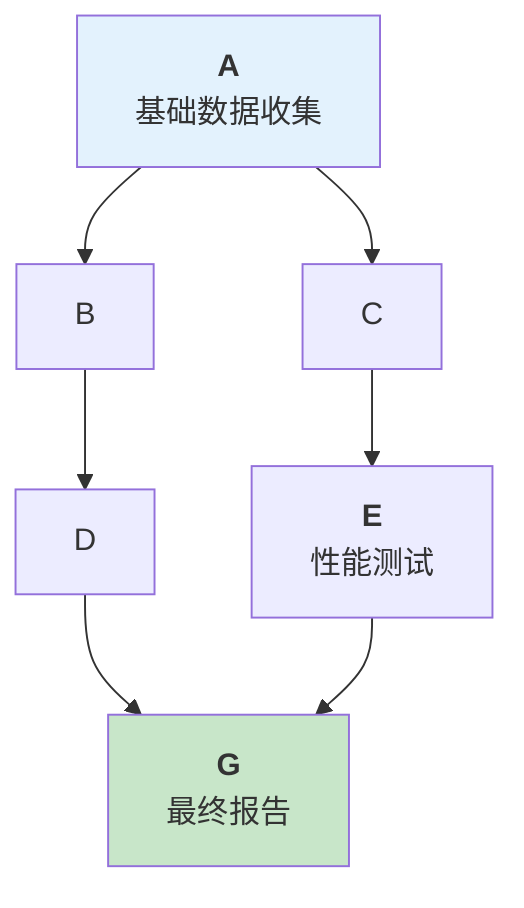
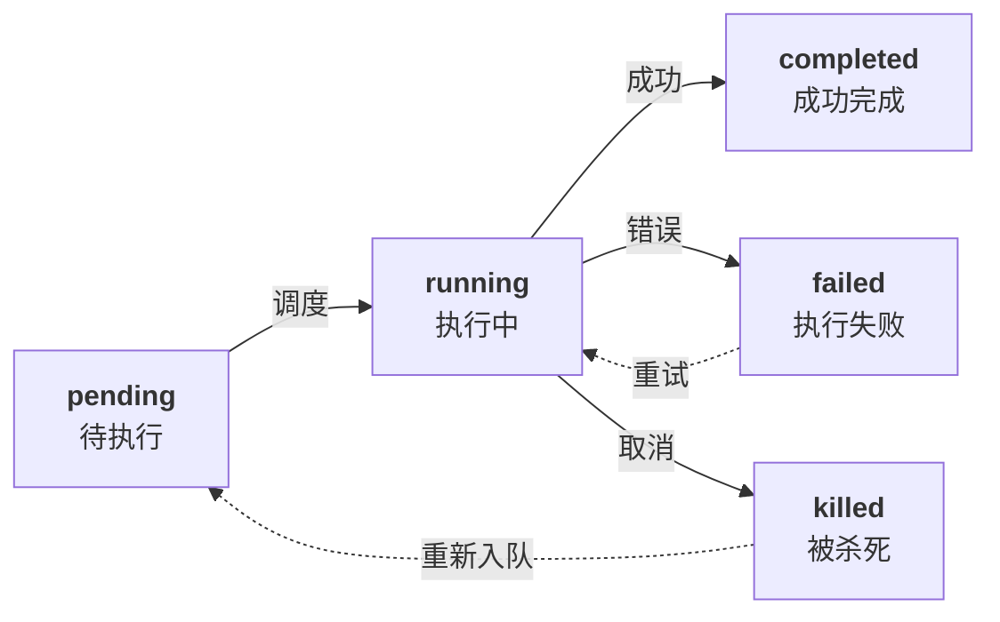
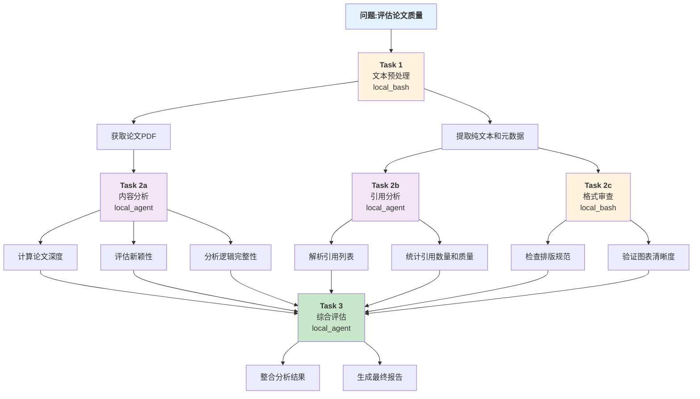
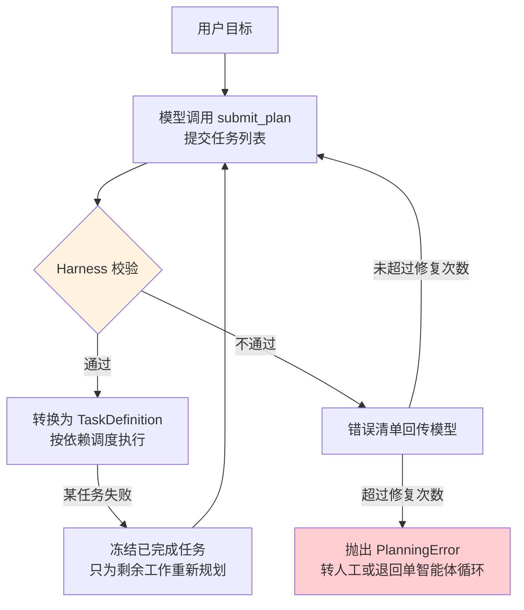

## 8.1 复杂任务分解与依赖建模

任务分解借助 DAG 模型管理任务间的依赖并实现并行执行。

### 8.1.1 核心概念：DAG 与任务图

任务分解的目标是将不可原子的大问题拆分为可独立执行的小任务，这些任务形成一个 **有向无环图(Directed Acyclic Graph, DAG)**。图中的节点代表任务，边代表任务间的依赖关系。



图 8-1：任务分解的 DAG 模型

依赖关系：A 必须在 B、C 前完成；B 必须在 D 前完成；C 必须在 E 前完成；G 必须在 D、E 都完成后执行。

DAG 模型有三个关键性质：

1. **无环性**：不允许循环依赖，保证任务最终会终止
2. **拓扑排序**：存在一个执行顺序，使所有依赖都被满足
3. **并行潜力**：无直接依赖的任务可以并行执行

### 8.1.2 Claude Code 的 Task 类型系统

Claude Code 为任务分解提供了 **7 种 Task 类型**，分别对应不同的执行环境和场景。

#### Task 类型总览

| Task 类型 | 执行环境 | 适用场景 | 智能体隔离 |
|---------|--------|--------|---------|
| local_bash | 本地 shell | 系统命令、文件操作 | 否 |
| local_agent | 本地 Agent | 代码分析、生成 | 是 |
| remote_agent | 远程 Harness | 分布式计算 | 是 |
| in_process_teammate | 内存中子智能体 | 轻量级分工 | 是 |
| workflow | Lobster 引擎 | 复杂工作流 | 部分 |
| monitor_mcp | MCP 监听 | 长期监控任务 | 是 |
| dream | 后台异步任务 | 并发非关键路径 | 是 |

**实现状态说明**：

- **MiniHarness 已实现**：`local_bash`、`local_agent`、`in_process_teammate` 三种任务执行类型提供了本地任务支持；`workflow` 由第 8.5 节的工作流引擎示例覆盖，尚未接入 `_execute_task()` 的任务分派路径
- **概念性设计/扩展**：`remote_agent`（分布式计算）、`monitor_mcp`（长期监控）、`dream`（异步后台任务）作为架构设计展示，具体实现留给读者根据需求自行实现

#### Task ID 格式规范

每个 Task 都有一个全局唯一的 ID，格式为：

```text
{parent_id}#{task_type}#{sequence}
```

例如：

- `root#local_agent#0`：根 Agent 下的第一个 local_agent 任务
- `root#local_agent#0#in_process_teammate#0`：嵌套的第一个 teammate 任务
- `root#workflow#2`：根 Agent 下的第三个 workflow 任务

### 8.1.3 任务生命周期

任务从创建到完成经历五个状态：



图 8-2：任务生命周期状态机

各状态含义：

1. **pending（待执行）**：任务已定义，但其依赖任务未全部完成
2. **running（执行中）**：依赖满足，任务开始执行
3. **completed（成功完成）**：任务执行成功，输出可用
4. **failed（执行失败）**：任务执行出错，决策者需决定是否重试
5. **killed（被杀死）**：人工中止或超时导致的任务终止


### 8.1.4 依赖建模：从问题到 DAG

#### 问题分析框架

把一个复杂问题分解为 DAG，流程如下：

1. **识别关键决策点**：问题的哪些部分可以并行处理？
2. **提取基础任务**：能否进一步分解某个任务？
3. **定义依赖关系**：哪些任务必须在其他任务之前执行？
4. **分配 Task 类型**：每个任务应该用何种方式执行？

#### 实例：论文质量评估系统

假设要构建一个系统来评估学术论文的质量，需要执行以下分析：



图 8-3：论文质量评估系统的任务分解示例

#### 依赖图的编程表示

任务 DAG 的完整 Python 实现如下：

```python
from typing import Dict, List, Set, Optional
from dataclasses import dataclass, field
from enum import Enum
import json

class TaskType(Enum):
    """7种Task类型"""
    LOCAL_BASH = "local_bash"
    LOCAL_AGENT = "local_agent"
    REMOTE_AGENT = "remote_agent"
    IN_PROCESS_TEAMMATE = "in_process_teammate"
    WORKFLOW = "workflow"
    MONITOR_MCP = "monitor_mcp"
    DREAM = "dream"

class TaskState(Enum):
    """任务生命周期状态"""
    PENDING = "pending"
    RUNNING = "running"
    COMPLETED = "completed"
    FAILED = "failed"
    KILLED = "killed"

@dataclass
class TaskDefinition:
    """任务定义"""
    task_id: str
    task_type: TaskType
    description: str
    dependencies: List[str] = field(default_factory=list)
    timeout_seconds: int = 300
    max_retries: int = 1
    execution_config: Dict = field(default_factory=dict)

    def add_dependency(self, task_id: str) -> None:
        """添加任务依赖"""
        if task_id not in self.dependencies:
            self.dependencies.append(task_id)

    def to_dict(self) -> dict:
        return {
            "task_id": self.task_id,
            "task_type": self.task_type.value,
            "description": self.description,
            "dependencies": self.dependencies,
            "timeout_seconds": self.timeout_seconds,
            "max_retries": self.max_retries,
            "execution_config": self.execution_config,
        }

class TaskDAG:
    """任务依赖图"""

    def __init__(self):
        self.tasks: Dict[str, TaskDefinition] = {}
        self.execution_order: List[str] = []

    def add_task(self, task_def: TaskDefinition) -> None:
        """添加任务定义"""
        self.tasks[task_def.task_id] = task_def

    def validate(self) -> bool:
        """验证DAG的合法性"""
        # 1. 检查所有依赖都存在
        for task_id, task in self.tasks.items():
            for dep_id in task.dependencies:
                if dep_id not in self.tasks:
                    raise ValueError(f"任务{task_id}依赖的任务{dep_id}不存在")

        # 2. 检查是否存在循环依赖
        if self._has_cycle():
            raise ValueError("检测到循环依赖")

        return True

    def _has_cycle(self) -> bool:
        """DFS检测循环依赖"""
        visited = set()
        rec_stack = set()

        def dfs(node: str) -> bool:
            visited.add(node)
            rec_stack.add(node)

            for neighbor in self.tasks[node].dependencies:
                if neighbor not in visited:
                    if dfs(neighbor):
                        return True
                elif neighbor in rec_stack:
                    return True

            rec_stack.remove(node)
            return False

        for task_id in self.tasks:
            if task_id not in visited:
                if dfs(task_id):
                    return True
        return False

    def topological_sort(self) -> List[str]:
        """拓扑排序,生成执行顺序"""
        self.validate()

        # 入度表
        in_degree = {task_id: 0 for task_id in self.tasks}
        for task in self.tasks.values():
            for dep_id in task.dependencies:
                in_degree[task.task_id] += 1

        # Kahn算法
        queue = [task_id for task_id in self.tasks if in_degree[task_id] == 0]
        order = []

        while queue:
            node = queue.pop(0)
            order.append(node)

            # 找到依赖于这个节点的所有任务
            for task_id, task in self.tasks.items():
                if node in task.dependencies:
                    in_degree[task_id] -= 1
                    if in_degree[task_id] == 0:
                        queue.append(task_id)

        self.execution_order = order
        return order

    def get_parallelizable_groups(self) -> List[List[str]]:
        """获取可并行执行的任务组"""
        # 断言:DAG必须已验证(无循环、无孤立节点)
        assert self.validate(), "DAG验证失败:存在循环或缺失依赖"

        self.topological_sort()
        groups = []
        completed = set()
        remaining = set(self.execution_order)

        while remaining:
            # 只把依赖已经在前一轮完成的任务放入同一并行层。
            # 同一层内的任务不能互相满足依赖，否则会把应串行的任务误排并行。
            ready = [
                task_id
                for task_id in self.execution_order
                if task_id in remaining
                and all(dep in completed for dep in self.tasks[task_id].dependencies)
            ]
            if not ready:
                raise ValueError("无法继续分组:存在循环依赖或缺失依赖")

            groups.append(ready)
            completed.update(ready)
            remaining.difference_update(ready)

        # 断言:所有任务都应被分配到某个组(无孤立节点)
        total_assigned = sum(len(g) for g in groups)
        assert total_assigned == len(self.tasks), \
            f"孤立节点:已分配{total_assigned}/{len(self.tasks)}个任务"

        return groups

    def visualize(self) -> str:
        """生成Mermaid图表代码"""
        lines = ["graph TD"]

        # 添加节点
        for task_id, task in self.tasks.items():
            label = f"{task.task_id}<br/>({task.task_type.value})"
            lines.append(f'    {task_id.replace("#", "_")}["{label}"]')

        # 添加边
        for task_id, task in self.tasks.items():
            for dep_id in task.dependencies:
                lines.append(f"    {dep_id.replace('#', '_')} --> {task_id.replace('#', '_')}")

        return "\n".join(lines)

# 使用示例
if __name__ == "__main__":
    dag = TaskDAG()

    # 添加任务
    dag.add_task(TaskDefinition(
        task_id="task_0",
        task_type=TaskType.LOCAL_BASH,
        description="获取论文数据"
    ))

    dag.add_task(TaskDefinition(
        task_id="task_1",
        task_type=TaskType.LOCAL_AGENT,
        description="内容分析",
        dependencies=["task_0"]
    ))

    dag.add_task(TaskDefinition(
        task_id="task_2",
        task_type=TaskType.LOCAL_AGENT,
        description="引用分析",
        dependencies=["task_0"]
    ))

    dag.add_task(TaskDefinition(
        task_id="task_3",
        task_type=TaskType.LOCAL_AGENT,
        description="综合评估",
        dependencies=["task_1", "task_2"]
    ))

    # 验证和排序
    order = dag.topological_sort()
    print("执行顺序:", order)

    # 获取并行组
    groups = dag.get_parallelizable_groups()
    print("并行组:", groups)

    # 生成可视化
    print(dag.visualize())
```

### 8.1.5 由模型生成任务图

上面的 DAG 由开发者逐个 `add_task` 手写。在智能体场景中，用户只给出目标，例如“评估这批论文”，任务图要由模型生成。这一步的分工是：**模型提出计划，Harness 判定计划能否执行**。模型生成的计划与其他模型输出一样不可信（见[第 7 章](../07_model_integration/README.md)）：它可能引用不存在的任务、含有循环依赖、使用未授权的任务类型，或者把可以并行的任务串成一条长链。Harness 必须在执行前拦下这些问题。

#### 适用范围

预先生成整张任务图，适合在开始前就能看清结构的任务，如批量文档处理、数据流水线、报告生成。编码、排障这类探索性任务，下一步做什么取决于上一步看到的结果，事先画出的图很快失效，通常在智能体循环中边执行边规划（见 [4.1 节](../04_runtime/4.1_agent_loop.md)），不预先生成 DAG。两种方式可以组合：外层按 DAG 调度，DAG 中的单个 `local_agent` 节点内部仍是一个普通的智能体循环。

#### 规划流程



图 8-4：由模型生成任务图的规划、校验与重规划流程

流程中有四个工程要点。

#### 1. 用工具调用取得结构化计划

不要让模型在自由文本里写一段 JSON 再用正则提取。Harness 把“提交计划”定义成一个工具，模型通过工具调用提交，参数天然是结构化对象。工具的 `input_schema` 同时把约束告诉模型：`task_type` 的枚举值取自 Harness 的策略，模型看到的可选类型与校验时允许的类型是同一份数据，不会出现提示词里写了一套、校验器里又是另一套的情况。

```python
def build_plan_tool(allowed_types, max_tasks):
    return {
        "name": "submit_plan",
        "description": f"提交任务计划。depends_on 列出必须先完成的任务 id。任务总数不超过 {max_tasks}。",
        "input_schema": {
            "type": "object",
            "properties": {"tasks": {"type": "array", "items": {
                "type": "object",
                "properties": {
                    "id": {"type": "string"},
                    "task_type": {"type": "string", "enum": [t.value for t in allowed_types]},
                    "description": {"type": "string"},
                    "depends_on": {"type": "array", "items": {"type": "string"}},
                },
                "required": ["id", "task_type", "description", "depends_on"],
            }}},
            "required": ["tasks"],
        },
    }
```

Schema 只能约束形状，约束不了语义：依赖是否指向存在的任务、图中有没有环，Schema 都表达不了，而且部分模型服务并不严格执行 Schema。所以 Schema 只是第一道约束，真正的判定在校验器。

#### 2. 确定性校验

校验器是普通代码，同一份计划永远得到同一份错误清单。检查分三层，前一层不通过就不做后一层：结构不对时谈不上引用，引用不对时谈不上环。

| 层次 | 检查内容 | 典型错误 |
|------|---------|---------|
| 字段与策略 | 任务数上限、id 唯一、类型在白名单内、描述非空 | 使用了策略未允许的 `remote_agent` |
| 引用完整性 | 每个依赖指向本计划或已完成的任务，且不指向自身 | `depends_on` 中出现不存在的 id |
| 图的形状 | 无环；最长依赖链不超过上限 | 环 a → b → a；可并行的任务被串成长链 |

```python
def validate(self, plan, frozen_ids=None):
    frozen = frozen_ids or set()
    if not isinstance(plan, dict) or not isinstance(plan.get("tasks"), list):
        return ["计划必须是包含 tasks 数组的对象"]
    if not plan["tasks"]:
        return ["tasks 不能为空"]
    return (
        self._check_fields(plan["tasks"], frozen)
        or self._check_references(plan["tasks"], frozen)
        or self._check_shape(plan["tasks"])
    )
```

最长依赖链的上限值得单独说明。模型倾向于把任务排成一条直线，“先做 A，再做 B，再做 C”，即使 B 与 C 互不依赖。链长上限迫使模型找出可以并行的部分，也限制了串行等待的总时长。环检测返回环上的完整路径（如 `a -> c -> b -> a`），而不是只说“有环”，因为这条信息要回传给模型去修。

#### 3. 带错误清单的修复回合

校验失败时，Harness 不直接放弃，也不悄悄改掉计划，而是把逐条错误回传给模型，让它在原计划上修改后重新提交：

```python
for _ in range(1 + self.max_repair_attempts):
    response = self.provider.complete_with_tools(messages, [self.tool])
    call = next((c for c in response.tool_calls if c.get("name") == "submit_plan"), None)
    errors = ["没有调用 submit_plan 工具"] if call is None \
        else self.validator.validate(call.get("arguments"), frozen_ids)
    if not errors:
        return self._to_definitions(call["arguments"])
    messages.append(ProviderMessage("assistant", f"已提交计划：{call and call.get('arguments')}"))
    messages.append(ProviderMessage("user", "计划未通过校验，请修正以下问题后重新调用 submit_plan：\n"
                                    + "\n".join(f"- {e}" for e in errors)))
raise PlanningError("计划仍不合法", errors)
```

修复次数必须有上限（MiniHarness 默认 2 次）。超过上限说明目标本身超出了模型在当前策略下的规划能力，继续重试只会消耗预算。此时抛出 `PlanningError`，由上层决定转人工，或者退回不预先规划的单智能体循环。Harness 不替模型“自动修好”计划，例如静默删掉一条不存在的依赖：那样执行的就不再是模型提出、也不是任何人审过的计划。

#### 4. 失败后的局部重规划

执行中某个任务失败，且重试（见 8.1.6 的容错策略）也无法恢复时，不应整张图推倒重来，已完成任务的结果是有成本的。重规划时 Harness 把已完成任务作为**冻结节点**交给模型：新计划可以在 `depends_on` 中引用它们，但不能重新定义它们。

```python
def replan(self, goal, completed, failed_task, error):
    """completed: 已完成任务 id -> 结果摘要"""
    prompt = (f"目标：{goal}\n已完成（不会重做，可被引用）：{completed}\n"
              f"任务 {failed_task} 失败：{error}\n只为尚未完成的工作提交新计划。")
    return self._plan_with_repair(prompt, frozen_ids=set(completed))
```

冻结约束同样由校验器执行：计划中若出现已完成任务的 id，就报“任务 fetch 已完成，不能重新定义”，进入修复回合。失败的任务如果需要换一种做法，模型应使用新的 id（如 `parse_v2`），这样执行日志里新旧两次尝试可以区分开。

完整实现见 `lab/mini_harness/orchestration/planner.py`，其中 `LLMPlanner` 输出的就是本节前面的 `TaskDefinition`，可以直接注册到 [8.5 节](8.5_miniharness_orchestration.md)的编排引擎。测试 `lab/tests/unit/test_planner.py` 用一个按脚本返回计划的假模型覆盖了环、悬空依赖、类型越权、链过长、修复成功、修复耗尽和冻结节点等情况，不需要真实的模型服务即可运行。

无论任务图由开发者手写还是由模型生成，都还需要做出几项直接影响系统效率和可维护性的设计决策。

### 8.1.6 关键设计决策

#### 1. 粒度选择

任务粒度太粗导致无法充分并行化，太细导致调度开销大。一般规则如下：

- **建议粒度**：单个 Task 的预期执行时间在 10 秒到 10 分钟间
- **太粗**：当某个任务的部分可以与其他任务并行时
- **太细**：当多个 Task 的总执行时间小于调度开销时

#### 2. 依赖 vs 控制流

需要明确区分两类依赖：

- **数据依赖**：后续任务需要前序任务的输出
- **控制流依赖**：后续任务需要前序任务完成但不需要其输出

二者的区别影响任务间的通信设计。

#### 3. 容错策略

为每个 Task 定义：

- **max_retries**：最多重试次数（默认 1）
- **timeout_seconds**：超时时间（默认 300 秒）
- **on_failure**：失败策略(fail-fast vs continue)

### 8.1.7 本节小结

任务分解的核心是建立 DAG 模型，并用 Claude Code 的 7 种 Task 类型适配不同执行环境。拓扑排序和并行组分析可以同时保证任务的执行顺序和并行效率。任务图由模型生成时，模型只负责提出计划；Harness 通过工具调用取得结构化计划，用确定性校验拦下非法的图，带着错误清单让模型修复，并在任务失败后冻结已完成节点、只重新规划剩余部分。下一节讨论如何用状态机实现更复杂的工作流逻辑。
