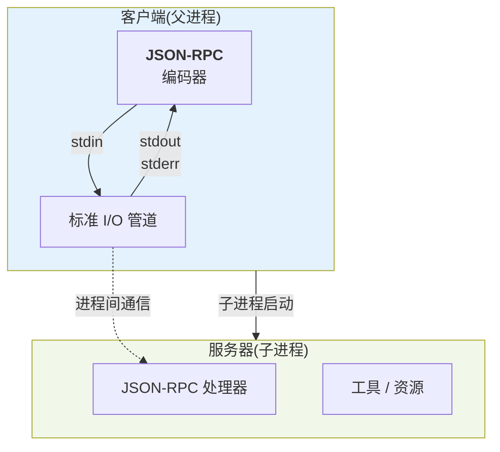
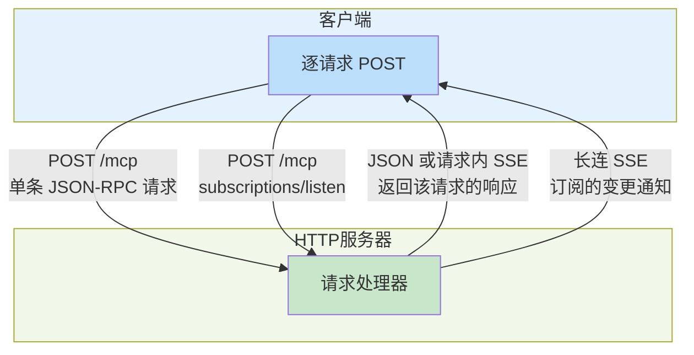
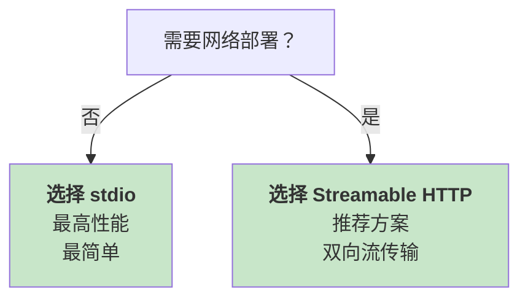

## 9.2 传输层：stdio 与 Streamable HTTP

MCP 是协议层的规范，消息还需要通过某种传输方式在 Client 和 Server 之间流通。传输层的选择影响性能、可靠性和部署方式。

当前 MCP 规范定义的标准传输是 **stdio** 与 **Streamable HTTP**。旧版 HTTP+SSE 属于历史兼容路径，不应再作为与 Streamable HTTP 并列的第三种标准传输来介绍。

### 9.2.1 stdio - 本地进程间通信

**工作原理**：

- Client 启动 Server 进程作为子进程
- 通过 stdin 向 Server 发送 JSON-RPC 消息（每行一个）
- 通过 stdout 从 Server 读取 JSON-RPC 消息（每行一个）
- 通过 stderr 接收 Server 的日志和错误



图 9-1：stdio 传输架构 —— 通过标准 I/O 进行本地进程间通信

**特点**：

| 特性 | 说明 |
|------|------|
| 架构 | 本地进程间通信 |
| 延迟 | 最低(<1ms) |
| 实现 | 最简单 |
| 部署 | 仅支持本地 |
| 扩展性 | 单 Client 单 Server |
| 容错 | Server 崩溃需要重启 Client |

**stdio 不等于会话**：进程一直开着，并不意味着 Server 可以把上一次请求的状态带到下一次。2026-07-28 修订版要求 Server 不得从同一连接上的历史请求推断状态；需要跨请求保留的状态，必须表达为一个显式标识符，由 Client 每次显式传入。下面的 stdio 客户端示例按当前修订版 **2026-07-28** 编写：没有握手，协议版本与客户端能力随每个请求的 `_meta` 传入，并可用 `server/discover` 一次性发现对端能力；在 stdio 上，它同时是判断对端使用新版还是旧版的探针。

**实现示例**：

```python
import json
import subprocess
from typing import Any, Callable, Dict, Optional

PROTOCOL_VERSION = "2026-07-28"
META_VERSION = "io.modelcontextprotocol/protocolVersion"
META_CAPABILITIES = "io.modelcontextprotocol/clientCapabilities"
META_CLIENT_INFO = "io.modelcontextprotocol/clientInfo"
META_LOG_LEVEL = "io.modelcontextprotocol/logLevel"
META_SERVER_INFO = "io.modelcontextprotocol/serverInfo"


class StdioMCPClient:
    """基于stdio的MCP客户端（2026-07-28 无状态模型）

    没有 initialize 握手，每个请求自带完整信封。子进程可以活很久，
    但它不是会话：Server 不得从同一管道上的历史请求推断任何状态。
    """

    def __init__(self, server_path: str, server_args: list = None):
        """启动MCP Server进程"""
        self.server_path = server_path
        self.server_args = server_args or []
        self.process: Optional[subprocess.Popen] = None
        self.request_id = 0
        # 仅客户端侧的本地缓存，属于优化，不构成协议状态
        self.server_info: Optional[Dict[str, Any]] = None

    def start(self) -> None:
        """启动Server进程。stderr 不重定向，Server 日志直接透传到父进程，
        免得管道写满后把子进程堵死"""
        self.process = subprocess.Popen(
            [self.server_path] + self.server_args,
            stdin=subprocess.PIPE,
            stdout=subprocess.PIPE,
            text=True,
            bufsize=1,  # 行缓冲
        )

    def _envelope(self, log_level: Optional[str] = None) -> Dict[str, Any]:
        """构造无状态请求信封。前两个键是必需的，逐请求重复携带是设计而非冗余；
        stdio 上没有 HTTP 头可用，信封只能落在 params._meta 里"""
        meta: Dict[str, Any] = {
            META_VERSION: PROTOCOL_VERSION,
            META_CAPABILITIES: {},
            META_CLIENT_INFO: {"name": "stdio-example", "version": "0.1.0"},
        }
        if log_level:
            # 日志级别也逐请求携带，取代已移除的 logging/setLevel
            meta[META_LOG_LEVEL] = log_level
        return meta

    def send_request(
        self,
        method: str,
        params: Dict[str, Any] = None,
        log_level: str = None,
        on_notification: Callable[[Dict[str, Any]], None] = None,
    ) -> Dict[str, Any]:
        """发送JSON-RPC请求并等待响应"""
        if not self.process:
            raise RuntimeError("Server not started")

        self.request_id += 1
        request_id = self.request_id

        # 每个请求都要注入信封；调用方自带的 _meta（如 progressToken）优先保留
        payload = dict(params or {})
        payload["_meta"] = {**self._envelope(log_level), **payload.get("_meta", {})}
        request = {
            "jsonrpc": "2.0",
            "id": request_id,
            "method": method,
            "params": payload,
        }

        # 写入请求
        self.process.stdin.write(json.dumps(request) + "\n")
        self.process.stdin.flush()

        # 读取响应：stdout 上会混进属于本请求的通知（进度、日志），
        # 必须读到同 id 的那条响应才算收工
        while True:
            response_line = self.process.stdout.readline()
            if not response_line:
                raise RuntimeError("Server closed connection")
            message = json.loads(response_line)
            if message.get("id") == request_id:
                # Server 在每个结果的 _meta 里回带 serverInfo，取代握手时的一次性自述
                meta = (message.get("result") or {}).get("_meta") or {}
                if META_SERVER_INFO in meta:
                    self.server_info = meta[META_SERVER_INFO]
                return message
            if "method" in message and "id" not in message:
                if on_notification:
                    on_notification(message)
                continue
            # 既不是本请求的响应，也不是通知。2026-07-28 的 Server 不会在这里反向
            # 发起请求：要客户端补输入时改走 MRTR，即在响应里返回 input_required
            raise RuntimeError(f"Unexpected message: {message}")

    def send_notification(self, method: str, params: Dict[str, Any] = None) -> None:
        """发送JSON-RPC通知，不等待响应"""
        if not self.process:
            raise RuntimeError("Server not started")
        notification = {"jsonrpc": "2.0", "method": method}
        if params:
            notification["params"] = params
        self.process.stdin.write(json.dumps(notification) + "\n")
        self.process.stdin.flush()

    def cancel(self, request_id: int, reason: str = "") -> None:
        """取消在途请求。HTTP 上关掉 SSE 流就是取消信号，
        stdio 上没有流可关，只能显式发 notifications/cancelled"""
        self.send_notification(
            "notifications/cancelled",
            {"requestId": request_id, "reason": reason},
        )

    def _unwrap(self, response: Dict[str, Any]) -> Dict[str, Any]:
        """取出 result，JSON-RPC 错误直接抛出"""
        if "error" in response:
            error = response["error"]
            raise RuntimeError(f"JSON-RPC error {error['code']}: {error['message']}")
        return response["result"]

    def discover(self) -> Optional[Dict[str, Any]]:
        """探测Server，一次拿到 supportedVersions 与 capabilities

        本示例只演示现代 Server 的探测。遇到 -32601 时返回 None，
        让调用方报告对端不支持此方法；完整的版本协商与旧版回退见下文。
        """
        response = self.send_request("server/discover")
        error = response.get("error")
        if error:
            if error.get("code") == -32601:
                return None
            raise RuntimeError(f"discover failed: {error}")
        return response["result"]

    def list_tools(self) -> Dict[str, Any]:
        """列出工具。结果自带 cacheScope/ttlMs，缓存放在客户端，Server 依然无状态"""
        return self._unwrap(self.send_request("tools/list"))

    def call_tool(
        self,
        tool_name: str,
        arguments: Dict[str, Any],
        progress_token: str = None,
        log_level: str = None,
        on_notification: Callable[[Dict[str, Any]], None] = None,
    ) -> Dict[str, Any]:
        """调用工具"""
        params: Dict[str, Any] = {
            "name": tool_name,
            "arguments": arguments,
        }
        if progress_token:
            # 进度这类请求内通知只走本请求的往返，不需要常驻订阅
            params["_meta"] = {"progressToken": progress_token}
        return self._unwrap(
            self.send_request(
                "tools/call",
                params,
                log_level=log_level,
                on_notification=on_notification,
            )
        )

    def close(self) -> None:
        """关闭连接"""
        if self.process:
            self.process.terminate()
            self.process.wait()

    def __enter__(self):
        self.start()
        return self

    def __exit__(self, exc_type, exc_val, exc_tb):
        self.close()

# stdio传输使用示例
if __name__ == "__main__":
    with StdioMCPClient("/path/to/mcp_server") as client:
        # 先探测：拿到能力清单，同时确认对端讲的是无状态版本
        info = client.discover()
        if info is None:
            raise SystemExit("对端不支持 server/discover，本示例仅支持新版流程")
        print("supportedVersions:", info["supportedVersions"])
        print("serverInfo:", client.server_info)

        # 列出可用工具：每个请求各自完备，不依赖上一次请求留下的痕迹
        listed = client.list_tools()
        print("tools:", [tool["name"] for tool in listed["tools"]])
        print("cache:", listed.get("cacheScope"), listed.get("ttlMs"))

        # 调用工具，顺带接收只属于这个请求的进度通知
        result = client.call_tool(
            "add",
            {"a": 2, "b": 3},
            progress_token="call-1",
            log_level="info",
            on_notification=lambda n: print("  notify:", n["method"], n["params"]),
        )
        print("resultType:", result["resultType"], "content:", result["content"])
```

**何时使用**：

- 本地开发和测试
- 单机应用
- 工具的快速原型
- 性能最优的场景（<100ms 延迟要求）

**限制**：

- 只能本地部署
- Server 崩溃需要重启 Client
- 不支持多 Client 访问同一 Server
- 网络分区完全不适用

### 9.2.2 Streamable HTTP - 双向 HTTP 流传输

**工作原理**：

- Server 是一个 HTTP 服务器，只暴露单一 MCP 端点，且只接受 POST；每条 JSON-RPC 消息都是一次独立的 POST
- Client 的 `Accept` 必须同时列出 `application/json` 与 `text/event-stream`
- 每个请求必须带 `MCP-Protocol-Version`（其值必须与 `params._meta` 中的协议版本一致，否则返回 `-32020` HeaderMismatch 与 HTTP 400）和 `Mcp-Method`（等于 method）；`tools/call`、`resources/read`、`prompts/get` 还必须带 `Mcp-Name`（等于 `params.name` 或 `params.uri`）
- Server 对一个请求的响应，要么是 `application/json` 单个对象，要么是仅作用于该请求的 `text/event-stream` 流：流上先送该请求相关的通知，最后送响应。Server 不得在这条流上发送独立的 JSON-RPC 请求
- 长期的变更通知不再靠常驻连接推送，而是由 Client POST `subscriptions/listen`，其响应本身就是一条长连 SSE，只承载客户端订阅的通知类型；进度、日志一类请求内通知不走这条流
- 关闭 SSE 响应流，就是 HTTP 上的取消信号
- 2026-07-28 版删除了 GET 流端点、协议级会话（`Mcp-Session-Id` 及其 DELETE 终止）与基于 `Last-Event-ID` 的断点续传
- 与旧版本共存：现实中大量服务器仍只支持 2025-11-25，GET 流端点、`Mcp-Session-Id` 会话与 `Last-Event-ID` 续传在那一版仍然有效。Client 应先按新版发一个请求做探测：若收到 HTTP 400，就检查响应体，是可识别的新版 JSON-RPC 错误则说明对方是新版服务器，按错误修正后重试；响应体为空或无法识别，则退回 `initialize` 握手走旧版。反过来，只支持 2026-07-28 的服务器对该端点上的 GET/DELETE 应返回 `405 Method Not Allowed`，并忽略 `Mcp-Session-Id` 与 `Last-Event-ID`



图 9-2：Streamable HTTP 传输架构 —— 单一 POST 端点，响应可为 JSON 或请求内 SSE

**特点**：

| 特性 | 说明 |
|------|------|
| 架构 | 单一 POST 端点，响应可为 JSON 或 SSE |
| 延迟 | 低(<100ms) |
| 实现 | 中等复杂度 |
| 部署 | 网络部署 |
| 扩展性 | 单 Server 多 Client |
| 重试 | 查询可按策略重试；有副作用的工具调用需要幂等保证 |

**实现示例**：

一次工具调用要对应一个 HTTP 请求。客户端把协议版本与能力放进 `params._meta`，在 HTTP 头里重复路由所需的信息。下面是教学客户端构建并发送请求的核心分支：

```python
async def send_request(self, method, params=None, timeout=30):
    request = self._build_request(method, params)
    async with self.session.post(
        f"{self.server_url}/mcp",
        json=request,
        headers=self._headers(method, request["params"]),
        timeout=aiohttp.ClientTimeout(total=timeout),
    ) as resp:
        if resp.content_type == "text/event-stream":
            async for message in self._iter_sse(resp):
                if message.get("id") == request["id"]:
                    return self._unwrap(message)
                self.on_notification(message)
            raise MCPRequestError(INVALID_REQUEST, f"{method} 的响应流提前结束")
        if resp.content_type != "application/json":
            raise MCPRequestError(INVALID_REQUEST, f"HTTP {resp.status}: 响应类型不符")
        return self._unwrap(await resp.json())
```

JSON 响应直接给出结果或错误；请求内 SSE 可以先发送进度通知，直到客户端收到与本次请求 ID 对应的响应。订阅使用另一条独立的长连接，关闭那条响应流即取消订阅。

[完整客户端、服务端与本地演示](../lab/examples/streamable_http_transport.py)保留了信封校验、错误处理与订阅实现。安装 `aiohttp` 后，从仓库根目录运行 `python lab/examples/streamable_http_transport.py`，程序会启动回环服务，依次探测协议、列出工具并打印 `Result: 3`。MiniHarness 实际使用的 [SDK 传输适配器](../lab/mini_harness/mcp/transports.py)可作对照。

**何时使用**：

- 网络部署（Client 和 Server 在不同机器）
- 多 Client 访问同一 Server
- Server 需要高可用（可以前置负载均衡器）
- 支持跨机房部署
- 大文件和流式数据传输

**优点**：

- 灵活的部署架构
- 请求无状态，天然适配多副本部署与负载均衡
- 统一的端点，简化配置
- 支持大型文件流式传输
- 标准 HTTP，易于代理和监控

**缺点**：

- 实现复杂度中等
- 每个请求都要重复携带元数据

#### 向后兼容：与仍在使用 initialize 握手的旧版 Server 互通

无状态模型是 2026-07-28 版才引入的，而线上大量 Server 仍然只支持 2025-11-25：先发 `initialize` 请求、再发 `notifications/initialized` 通知，随后用 `Mcp-Session-Id` 维持会话。规范本身给出了互通规则，客户端需要同时能走这两条路。

**HTTP 上的探测顺序**：先按新版发一个正常请求；如果返回 HTTP 400，就检查响应体：能识别出新版 JSON-RPC 错误码（如 `-32020`、`-32022`、`-32602`），说明对方就是新版 Server，按错误纠正后重试；只有响应体为空或无法识别时，才回落到 `initialize` 握手，按旧版流程继续。

**stdio 上的探测**：用 [`server/discover` 探测](https://modelcontextprotocol.io/specification/2026-07-28/basic/transports/stdio#backward-compatibility)，在 `_meta` 中带上首选新版版本。收到发现结果时，从服务端公布的版本中选双方都支持的版本；收到可识别的新版错误时继续走新版，例如版本不受支持就尝试服务端公布的兼容版本。收到其他错误或等待超时时，才回落到 `initialize`。旧版对端可能返回不同错误码，回退逻辑不能只识别 `-32601`。

**只支持新版的 Server 面对旧流量**：端点上的 GET 与 DELETE 应返回 `405 Method Not Allowed`，忽略请求里的 `Mcp-Session-Id`，忽略 `Last-Event-ID`。

**旧 HTTP+SSE 传输（2024-11-05）处于弃用期，尚未删除**：它自 2025-03-26 起就被标注为弃用，不适用其他弃用特性至少 12 个月的窗口，[弃用特性登记表](https://modelcontextprotocol.io/specification/2026-07-28/deprecated)给出的最早移除时间是「SEP-2596 定稿后三个月」，实际移除时间由核心维护者在准备新修订版时决定（见 [9.1 节](9.1_protocol_design.md)）。新实现一律用 Streamable HTTP，存量实现应优先迁移。


### 9.2.3 传输层选择决策与连接管理

#### 传输方式的选择决策

传输方式的选择决策过程如下：



图 9-3：传输方式选择决策树 —— 根据部署需求选择合适的传输方式

#### 连接管理与池化

无论采用哪种传输方式，都需要考虑连接的管理和复用。

**stdio 情况下的连接管理：**

```python
class StdioConnectionPool:
    """stdio连接池"""

    def __init__(self, max_connections: int = 10):
        self.max_connections = max_connections
        self.connections = {}
        self.lock = asyncio.Lock()

    async def get_connection(self, server_path: str) -> StdioMCPClient:
        """获取连接(如果没有则创建)"""
        async with self.lock:
            if server_path not in self.connections:
                if len(self.connections) >= self.max_connections:
                    # 关闭最少使用的连接
                    oldest = min(
                        self.connections.items(),
                        key=lambda x: x[1]['last_used']
                    )
                    oldest[1]['client'].close()
                    del self.connections[oldest[0]]

                client = StdioMCPClient(server_path)
                client.start()
                self.connections[server_path] = {
                    'client': client,
                    'last_used': asyncio.get_running_loop().time(),
                }

            return self.connections[server_path]['client']

    async def release_connection(self, server_path: str) -> None:
        """释放连接(更新使用时间)"""
        async with self.lock:
            if server_path in self.connections:
                self.connections[server_path]['last_used'] = asyncio.get_running_loop().time()
```

**HTTP 情况下的连接管理：**

```python
class HttpConnectionPool:
    """HTTP连接池(使用aiohttp的连接池)"""

    def __init__(self, max_connections: int = 100):
        self.connector = aiohttp.TCPConnector(
            limit=max_connections,
            limit_per_host=10,
        )
        self.session = aiohttp.ClientSession(connector=self.connector)

    async def get_client(self, server_url: str) -> StreamableHttpMCPClient:
        """获取HTTP客户端"""
        return StreamableHttpMCPClient(server_url)

    async def close(self) -> None:
        """关闭所有连接"""
        await self.session.close()
```

**OAuth 认证流程：** 在 HTTP 传输中，现代 MCP Server 不应假设固定的 `/oauth/authorize` / `/oauth/token` 路径。客户端应先处理 Server 返回的 `401` 与 `WWW-Authenticate` 挑战，读取 OAuth Protected Resource Metadata，再发现授权服务器元数据，并在令牌请求中带上 `resource` 参数。另外，在 2026-07-28 修订版中，OAuth 2.0 动态客户端注册（DCR）进入至少 12 个月的弃用期（仍然可用，但新实现不建议采用），官方建议改用 Client ID Metadata Documents 标识客户端。

```python
class OAuthMCPClient:
    """按 MCP 授权规范发现端点的 HTTP MCP 客户端骨架"""

    def __init__(self, server_url: str, client_id: str):
        self.server_url = server_url
        self.client_id = client_id
        self.access_token = None
        self.session = None

    async def discover_authorization(self) -> dict:
        """从 401 challenge / protected-resource metadata 发现授权服务器"""
        challenge = await self.fetch_www_authenticate_challenge()
        resource_metadata = await self.fetch_protected_resource_metadata(challenge)
        return await self.fetch_authorization_server_metadata(resource_metadata)

    async def authenticate(self, requested_scopes: Optional[list[str]] = None) -> None:
        """执行 OAuth 授权码 + PKCE 流程(默认按资源元数据公布的scope申请)"""
        metadata = await self.discover_authorization()
        if requested_scopes is None:
            requested_scopes = metadata.get("scopes_supported", [])
        resource = self.server_url

        auth_params = {
            "client_id": self.client_id,
            "response_type": "code",
            "redirect_uri": "http://localhost:8080/callback",
            "scope": " ".join(requested_scopes),
            "resource": resource,
            "code_challenge": "...",
            "code_challenge_method": "S256",
        }

        # 浏览器跳转到 metadata["authorization_endpoint"]，拿到授权码后换 token
        token_data = {
            "grant_type": "authorization_code",
            "code": "...",
            "client_id": self.client_id,
            "code_verifier": "...",
            "resource": resource,
        }

        async with aiohttp.ClientSession() as session:
            async with session.post(metadata["token_endpoint"], data=token_data) as resp:
                token_response = await resp.json()
                self.access_token = token_response["access_token"]

        self.session = aiohttp.ClientSession(
            headers={"Authorization": f"Bearer {self.access_token}"}
        )

    async def send_request(self, method: str, params: Dict[str, Any]) -> Dict[str, Any]:
        """发送认证的请求"""
        if not self.access_token:
            await self.authenticate()

        request = {
            "jsonrpc": "2.0",
            "id": 1,
            "method": method,
            "params": params,
        }

        async with self.session.post(
            f"{self.server_url}/mcp",
            json=request,
        ) as resp:
            return await resp.json()
```

### 9.2.4 本节小结

传输层的选择是设计 MCP 集成架构的关键决策。stdio 提供最高性能但不支持网络部署，Streamable HTTP 是网络部署的推荐方案：单一端点、逐请求 POST，响应可以是 JSON，也可以是该请求专属的 SSE 流。

关键要点：

- 本地/单机 → stdio
- 网络/多 Client → Streamable HTTP
- 两种传输都已没有握手：协议版本与客户端能力随每个请求放在 `params._meta` 里
- Streamable HTTP 只接受 POST，请求必带 `MCP-Protocol-Version` 与 `Mcp-Method`，`tools/call`、`resources/read`、`prompts/get` 还要带 `Mcp-Name`
- 长期变更通知走 `subscriptions/listen`；`Mcp-Session-Id` 与 `Last-Event-ID` 已被删除
- SSE 是 Streamable HTTP 的流式响应格式之一；旧 HTTP+SSE 传输处于废弃期，仍可用但不应新采用
- 总是考虑连接池复用
- HTTP 环境中实现 OAuth 认证

下一节讨论 MCP Server 的实现。
