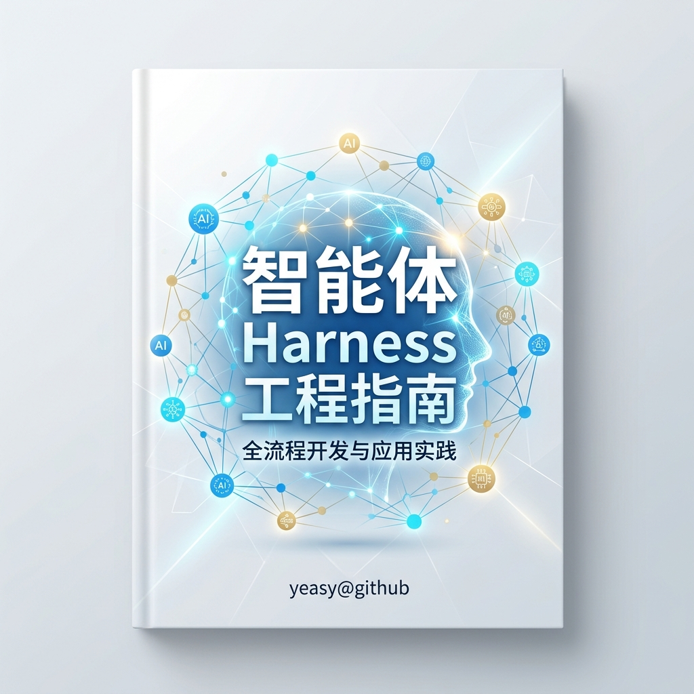

# 智能体 Harness 工程指南

设计智能体的运行时、工具、记忆与安全机制，并用 Python 逐步实现 MiniHarness。

**[在 GitBook 阅读第一章 · Harness 工程概论](https://yeasy.gitbook.io/harness_engineering_guide/di-yi-bu-fen-harness-gong-cheng-ji-chu/01_harness_intro)**

[全书目录（GitHub）](https://github.com/yeasy/harness_engineering_guide/blob/main/SUMMARY.md) · [正式 PDF（发布页）](https://github.com/yeasy/harness_engineering_guide/releases/latest)



## 关于本书

随着智能体工程进入生产场景，越来越多的生产案例表明： **模型能力只是必要条件，外围 Harness 系统决定了能力能否稳定转化为结果**。

“Harness 工程”(Harness Engineering)这一概念开始进入主流视野。多个生产级智能体项目(Agent)的经验表明：当基础模型接近同一能力带时，差异往往转移到围绕模型构建的工程系统。

本书用一个工程化简写来概括： **智能体 = 大模型 + Harness**。大模型提供推理的“大脑”，Harness 提供执行、记忆与安全保障的“身体”。验证循环、重试策略、状态管理、检查点恢复等 Harness 层能力，决定了一个智能体系统能否从原型走向生产。软件工程社区开始系统化地探讨这一工程范式。

Harness 一词意为“驾驭”，原指骑手驾驭烈马所用的缰绳和鞍具系统。骑手借缰绳和鞍具把烈马的奔腾之力化为可控的前行；Agent Harness 则把大模型的推理能力转化为可靠、可控、可观测的生产级系统。它包含运行时引擎、工具层、记忆子系统、编排引擎、安全体系和可观测性基础设施等核心子系统。

本书不讲“Agent 是什么”，这是 [《智能体 AI 权威指南》](https://yeasy.gitbook.io/agentic_ai_guide) 的主题；不讲“上下文如何管理”，这属于 [《大模型上下文工程权威指南》](https://yeasy.gitbook.io/context_engineering_guide) 的范围；也不讲“AI 安全攻防”，[《大模型安全权威指南》](https://yeasy.gitbook.io/ai_security_guide) 已有深入论述。本书只回答一个问题： **如何设计和构建驱动智能体的工程基础设施**。

## 从哪里开始

本书面向具备 AI Agent 基础的工程师、架构师和技术决策者。跟做 MiniHarness 需要 Python 编程经验。

- **理解系统设计** · 从[通用参考架构](https://yeasy.gitbook.io/harness_engineering_guide/di-yi-bu-fen-harness-gong-cheng-ji-chu/02_architecture/2.1_reference_architecture)看清各层职责，再追踪[智能体循环](https://yeasy.gitbook.io/harness_engineering_guide/di-er-bu-fen-harness-he-xin-zi-xi-tong/04_runtime/4.1_agent_loop)中的消息、模型与工具调用。
- **在本地运行 MiniHarness** · 按[实战项目的快速开始](https://github.com/yeasy/harness_engineering_guide/blob/main/lab/README.md#快速开始)安装依赖并运行示例，再按[附录 D · MiniHarness 实战项目](https://yeasy.gitbook.io/harness_engineering_guide/fu-lu/appendix/miniharness_index)对照章节与代码。
- **把原型带入生产** · 从[生产级 Harness 构建](https://yeasy.gitbook.io/harness_engineering_guide/di-san-bu-fen-xi-tong-ji-cheng-yu-gong-cheng-shi-jian/10_production)着手，再读[容错与可靠性工程](https://yeasy.gitbook.io/harness_engineering_guide/di-san-bu-fen-xi-tong-ji-cheng-yu-gong-cheng-shi-jian/11_reliability)、[Harness 安全体系](https://yeasy.gitbook.io/harness_engineering_guide/di-si-bu-fen-an-quan-ping-gu-yu-yan-jin/12_security)和[评估与质量保障](https://yeasy.gitbook.io/harness_engineering_guide/di-si-bu-fen-an-quan-ping-gu-yu-yan-jin/13_evaluation)。

<details>

<summary>按角色选读</summary>

读完第 1–3 章的 Harness 工程基础后，可按工作重点选读。

- **Agent 平台工程师** · 读第 4–7 章的核心子系统，再读[生产构建](https://yeasy.gitbook.io/harness_engineering_guide/di-san-bu-fen-xi-tong-ji-cheng-yu-gong-cheng-shi-jian/10_production)与[可靠性](https://yeasy.gitbook.io/harness_engineering_guide/di-san-bu-fen-xi-tong-ji-cheng-yu-gong-cheng-shi-jian/11_reliability)（第 10–11 章）。
- **AI 应用架构师** · 读第 8–9 章的任务编排与 MCP 集成，再读[第 12 章的安全体系](https://yeasy.gitbook.io/harness_engineering_guide/di-si-bu-fen-an-quan-ping-gu-yu-yan-jin/12_security)。
- **全栈开发者** · 跟做第 4–7 章的 MiniHarness 核心模块，再按[附录 D](https://yeasy.gitbook.io/harness_engineering_guide/fu-lu/appendix/miniharness_index)完成集成与测试。
- **技术决策者** · 读[第 12 章的权限与隔离设计](https://yeasy.gitbook.io/harness_engineering_guide/di-si-bu-fen-an-quan-ping-gu-yu-yan-jin/12_security)，再读[第 14 章的技术演进与标准化](https://yeasy.gitbook.io/harness_engineering_guide/di-si-bu-fen-an-quan-ping-gu-yu-yan-jin/14_future)。

</details>

## 全书结构

- **Harness 工程基础（第 1–3 章）** · 界定 Harness 的职责，建立参考架构与设计原则，在[第 2 章](https://yeasy.gitbook.io/harness_engineering_guide/di-yi-bu-fen-harness-gong-cheng-ji-chu/02_architecture)搭建 MiniHarness 脚手架。
- **Harness 核心子系统（第 4–7 章）** · 从[运行时引擎](https://yeasy.gitbook.io/harness_engineering_guide/di-er-bu-fen-harness-he-xin-zi-xi-tong/04_runtime)开始，逐步实现工具、记忆和输出治理。
- **系统集成与工程实践（第 8–11 章）** · 从[任务编排](https://yeasy.gitbook.io/harness_engineering_guide/di-san-bu-fen-xi-tong-ji-cheng-yu-gong-cheng-shi-jian/08_orchestration)进入工作流与多智能体协作，再集成 MCP 并加固生产可靠性。
- **安全、评估与演进（第 12–14 章）** · 从[安全体系](https://yeasy.gitbook.io/harness_engineering_guide/di-si-bu-fen-an-quan-ping-gu-yu-yan-jin/12_security)入手，设计权限与隔离机制，建立评估与测试流程，了解后续演进方向。

## 实战项目 MiniHarness

全书贯穿一个从零构建的实战项目 **MiniHarness**：一个最小但完整的 Agent Harness 系统，使用 **Python** 实现。

MiniHarness 从第一章介绍、第二章搭建脚手架开始，每章在前一章的基础上逐步添加子系统：运行时引擎 → 工具层 → 记忆子系统 → 输出治理 → 编排引擎 → MCP 集成 → 生产化加固 → 可靠性保障 → 安全层 → 测试验收。全书读完，读者将拥有一个包含所有核心子系统的可运行 Harness。

## 三大参考系统

全书以三个具有代表性的生产级公开参考系统作为核心参考案例，贯穿始终。本书按主要优化目标划分：性能型强调执行效率与沙箱，任务型强调交互工作流，自驱型强调后台唤醒与长期状态。

参考系统变化较快，本书正文只保留稳定架构特征；具体产品与特性名可见 [附录 C：推荐资源](appendix/resources.md)。

<details>

<summary>比较 Codex、Claude Code 和 OpenClaw</summary>

**[OpenAI Codex](https://github.com/openai/codex)** 代表 **性能型智能体** 的 Harness 范式。它以 Rust 为核心实现语言，通过系统级编程实现了高性能、内存安全的 Harness 架构。其特色包括：基于 Starlark 的执行策略引擎(execpolicy)、平台原生沙箱（Linux 上优先用 `PATH` 上找到的第一个 Bubblewrap，找不到时回退到 Codex 自带的 `codex-resources/bwrap`；Bubblewrap 生效期间再叠加 `PR_SET_NO_NEW_PRIVS` 与 seccomp 网络过滤，Landlock 则退为需显式打开 `features.use_legacy_landlock` 的遗留路径。macOS 使用 Seatbelt/sandbox-exec，Windows 原生支持 `elevated` / `unelevated` sandbox；WSL2 走与 Linux 相同的 Bubblewrap 路径）、skills/core-skills 技能模块体系、OpenTelemetry 原生可观测性（otel 模块），以及内置 MCP 服务端支持等。

**[Claude Code](https://github.com/anthropics/claude-code)** 代表 **任务型智能体** 的 Harness 范式。它围绕终端交互场景构建工程系统，核心特色包括：可直接读写代码库、运行命令、接入 MCP，提供 default、acceptEdits、plan、auto、dontAsk、bypassPermissions 等权限模式，并通过 skills、hooks、subagents、memory/compact 等公开机制扩展工作流。

**[OpenClaw](https://github.com/openclaw/openclaw)** 代表 **自驱型智能体** 的 Harness 范式。它通过 Gateway 控制平面、Heartbeat/cron 触发机制和多渠道接入层，支持后台自动化运行。其 Harness 特色包括：Gateway 协议、基于配置的工具权限与执行审批、`MEMORY.md` + `memory/YYYY-MM-DD.md` 的明文记忆文件、Lobster 确定性工作流，以及作为公开 skills/plugins 注册中心的 ClawHub。更多内容可参考 [《OpenClaw 从入门到精通》](https://yeasy.gitbook.io/openclaw_guide)。

这三个系统分别展示了 Harness 工程在不同场景和技术路线下的设计取舍：

| 维度 | Codex（性能型） | Claude Code（任务型） | OpenClaw（自驱型） |
|------|--------------------|-----------------------|--------------------|
| 核心实现 | Rust | 以官方发布形态为准 | TypeScript/Gateway 架构 |
| 触发方式 | 用户指令驱动 | 用户指令驱动 | Heartbeat 自主唤醒 + 定时任务 |
| 运行模式 | 按需启动、完成即停 | 按需启动、完成即停 | 持续后台运行 |
| 工具生态 | skills + core-skills 模块 + MCP | 内置工具 + MCP + skills 扩展 | ClawHub skills/plugins 注册中心 |
| 记忆模型 | state 模块会话管理 | 公开记忆/compact/hooks 机制 | `MEMORY.md` + 每日记忆文件 |
| 安全模型 | execpolicy 策略引擎(allow/prompt/forbidden) | 分模式权限控制 + 规则配置 | 工具 allow/deny + exec 审批策略 |
| 沙箱实现 | 平台原生沙箱（Bubblewrap + seccomp，自带 bwrap 兜底）| 权限模式 + 可选 dev container/VM 隔离 | main 默认主机执行，non-main 可启用 Docker/SSH/OpenShell 沙箱 |
| 多智能体 | 分层 Agent 消息协议 | Coordinator 模式 + 子智能体 | Lobster 工作流引擎 |
| 可观测性 | OpenTelemetry 原生集成 | OpenTelemetry 导出指标与事件（traces 为 beta） | 每日记忆日志 |

</details>

## 延伸阅读

<details>

<summary>与系列图书的关系</summary>

本书是 AI 工程系列图书之一，与其他图书形成互补：

| 图书 | 聚焦层次 | 核心问题 |
|------|---------|---------|
| [零基础学 AI](https://yeasy.gitbook.io/ai_beginner_guide) | 概念层 | AI 是什么、怎么用 |
| [大模型提示词工程指南](https://yeasy.gitbook.io/prompt_engineering_guide) | 交互层 | 如何与大模型高效对话 |
| [大模型上下文工程权威指南](https://yeasy.gitbook.io/context_engineering_guide) | 技术层 | 如何管理 LLM 的上下文 |
| [智能体 AI 权威指南](https://yeasy.gitbook.io/agentic_ai_guide) | 理论层 | Agent 的范式、推理、记忆与协作 |
| [Claude 技术指南](https://yeasy.gitbook.io/claude_guide) | 产品层 | Claude 生态的全面使用 |
| [大模型安全权威指南](https://yeasy.gitbook.io/ai_security_guide) | 安全层 | AI 系统的攻防与合规 |
| [大模型原理与架构](https://yeasy.gitbook.io/llm_internals) | 原理层 | 大语言模型底层逻辑与架构 |
| [OpenClaw 从入门到精通](https://yeasy.gitbook.io/openclaw_guide) | 实践层 | OpenClaw 的部署与使用 |
|**本书：Harness 工程**|**基础设施层**|**如何构建驱动 Agent 的工程系统**|

</details>

## 反馈与贡献

欢迎在 [GitHub Issues](https://github.com/yeasy/harness_engineering_guide/issues) 报告勘误或提出建议，也可以[提交 Pull Request](https://github.com/yeasy/harness_engineering_guide/pulls)。

<details>

<summary>本地开发与预览</summary>

安装 [mdPress](https://github.com/yeasy/mdpress) 后，在仓库根目录启动本地预览，再打开 `http://localhost:9000`。

```bash
brew tap yeasy/tap && brew install mdpress
mdpress serve
```

[默认分支 PDF 预览版](https://github.com/yeasy/harness_engineering_guide/releases/download/preview-pdf/harness_engineering_guide.pdf)随主线更新，正式版本以发布页为准。

</details>

## 许可证

本书采用 [CC BY-NC-SA 4.0](https://creativecommons.org/licenses/by-nc-sa/4.0/) 许可证。

您可以自由分享和演绎，但需署名、非商业使用、相同方式共享。
